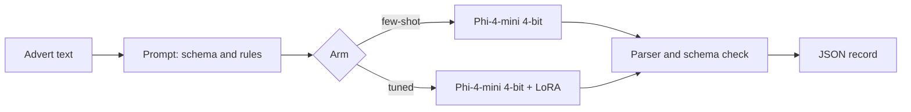

# sponsor-scout

Paste a UK job advert, get clean JSON and a straight answer on visa sponsorship, from a small open model you fine-tune on your own laptop, with a pre-registered test of whether the tuning was worth it.

[](https://github.com/Onkar-Gupta/sponsor-scout/actions/workflows/tests.yml)
[](LICENSE)

## Quick Start

```bash
git clone https://github.com/Onkar-Gupta/sponsor-scout && cd sponsor-scout
pip install -r requirements.txt && pip install -e .
pytest                      # 106 tests, CPU only, about 2 seconds
```

To train and run the model you need an NVIDIA GPU with 8 GB. See [Train and extract](#train-and-extract).

## Demo

Real output from the tuned model on a synthetic test advert (left: the advert; right: the model's answer). Demo GIF: TBC.

```text
Machine Learning Engineer                     {"title": "Machine Learning Engineer",
Gloama Ltd                                     "employer": "Gloama Ltd",
Location: Leeds                                "location": "Leeds",
Working pattern: on-site                       "salary_min": 54000, "salary_max": 64000,
Salary: £54k - £64k                            "work_pattern": "on-site",
Experience required: minimum 6 years           "skills": ["data modelling", "sql", "looker",
Skills required: data modelling, SQL,                      "power bi", "tableau"],
  looker, power bi and tableau                 "years_experience_min": 6,
...                                            "closing_date": "2027-01-04",
Visa support available for some roles.         "sponsorship": "unclear"}
Closing date: 4 January 2027
```

"Visa support available for some roles" is hedged, so the label is `unclear`. The labelling rules are in [`eval/labelling_guide.md`](eval/labelling_guide.md).

## What it does

It reads one UK job advert and returns ten fields as JSON: title, employer, location, salary range (in pounds a year), work pattern, skills, minimum years of experience, closing date and a **sponsorship stance**: `offers`, `excludes`, `not_stated` or `unclear`. A missing value is `null`, never a guess.

The question behind the project: is fine-tuning a 3.8 billion parameter model (QLoRA) worth it compared with a carefully written few-shot prompt on the same model? The pass marks were written down before any data or model output existed, and are in [`eval/protocol.md`](eval/protocol.md).

## Results

Base model: Phi-4-mini-instruct (MIT), 4-bit. Test set: **50 of 600 synthetic test adverts** (25 in-style, 25 in styles never seen in training), chosen by a fixed seed before any model ran. Each arm ran once. Intervals are 95 percent paired bootstrap intervals.

| Arm | Valid JSON | Mean field accuracy | Sponsorship accuracy | Sponsorship macro-F1 | Invented-value rate | Whole record right | Median time |
|---|---|---|---|---|---|---|---|
| Base, zero-shot | 0.00 | 0.000 | 0.00 | 0.000 | n/a | 0.00 | 7.2 s |
| Base, 5-example prompt | 0.82 | 0.736 | 0.64 | 0.710 | 0.342 | 0.32 | 7.7 s |
| **Tuned (LoRA)** | **1.00** | **0.993** | **0.98** | **0.979** | **0.000** | **0.96** | 1.2 s* |
| Base, constrained decoding (Ollama) | 1.00 | 0.898 | 0.72 | 0.695 | 0.176 | 0.26 | 3.5 s |

\*The tuned arm ran at batch size 8, the others at batch size 1, so times are not comparable. Zero-shot scores 0 because every output broke the schema (for example `skills` written as one comma-separated string).

### Pre-registered pass marks

| # | Mark | Result | Met |
|---|---|---|---|
| 1 | Tuned beats the prompt by at least 5 points on mean field accuracy, interval above 0 | +25.8 points (interval 16.4 to 36.4) | Yes |
| 2 | Same on the 25 unseen-style adverts | +31.6 points (interval 16.0 to 48.4) | Yes |
| 3 | Sponsorship macro-F1 at least the prompt's, interval above 0 | 0.979 against 0.710 (difference interval 0.15 to 0.41) | Yes |
| 4 | Tuned JSON validity at least 0.99 | 1.000 (95 percent Wilson lower bound 0.929) | Yes |
| 5 | Tuned invents no more values than the prompt | 0.000 against 0.342 (difference interval -0.47 to -0.23) | Yes |
| 6 | General ability (MMLU, 1,000 questions) no more than 2 points lower | 0.629 against 0.631 (difference interval -1.7 to +1.3 points) | Yes |

### Real adverts (10, smoke check only)

I copied 10 real UK adverts from LinkedIn and labelled them with the same guide before any model saw them. The labels were drafted from the guide and checked by me.

| Arm | Valid JSON | Mean field accuracy | Sponsorship accuracy |
|---|---|---|---|
| Base, 5-example prompt | 0.50 | 0.322 | 0.10 |
| Tuned (LoRA) | 0.90 | 0.700 | 0.60 |
| Base, constrained decoding | 1.00 | 0.744 | 0.60 |

The tuned model falls from 0.993 on synthetic adverts to 0.700 on real ones. With 10 adverts this is a smoke check, not a measurement. It shows that the synthetic result overstates real use. Constrained decoding does best on real text (it cannot break the format), which suggests combining it with the tuned adapter. That has not been tried.

Training cost: 2,000 examples, 2 epochs, 250 optimiser steps, 54 minutes, 3.57 GiB peak GPU memory (`reports/dev_train_r16_lr2e-4_e2.json`). Every number above comes from a file in [`reports/`](reports/).

### What these results do not show

- The test adverts are synthetic. I wrote the generator, so the tuned model learned the generator's habits. The held-out styles reduce this but do not remove it.
- 50 test adverts give wide intervals, and 25 for mark 2. The other 550 were not run, by decision, and the protocol says the 50-advert result is final.
- The private set is 10 adverts, all from LinkedIn, none with a closing date or an hourly or daily rate.
- One base model, one training run chosen on a dev set, one seed.
- "Unclear" is a judgement class. The rules are mine.
- A sponsorship answer says what the advert says. It is not legal advice, and a licence on the UK sponsor register does not mean this job is sponsored.

## How it works



1. `scripts/make_adverts.py` generates 2,900 synthetic adverts with known labels (train 2,000, dev 300, test 600) from original templates. Employers are fictional. Test styles and sponsorship phrasings never appear in train.
2. `scripts/train.py` fine-tunes a LoRA adapter (rank 16, learning rate 2e-4, 2 epochs) on the train split.
3. `scripts/run_arm.py` runs each arm on a split with greedy decoding. `scripts/score_run.py` scores the output and computes the pass marks.
4. Settings were tuned on the dev split only, then frozen in an Amendment before the test split was run once.

## Project structure

```text
sponsor_scout/      generator, schema, prompts, inference, scorer, training
scripts/            make_adverts, train, run_arm, score_run, mmlu_check, make_subset, check_private
eval/               protocol.md (pre-registered, with dated Amendments), labelling_guide.md
data/               train, dev and test adverts (CC0), subset ids, hashes; private/ is gitignored
prompts/            the three few-shot prompt versions tried on dev
reports/            every dev run and every official result
tests/              106 tests, including a guard that the frozen data never changes
config.yaml         all settings
```

## Configuration

Everything is in [`config.yaml`](config.yaml): the base model, generator sizes and seeds, decoding length, the allowed training grid (rank 8 or 16, learning rate 1e-4 or 2e-4, 1 to 3 epochs), batch sizes and paths. There are no hardcoded values in the scripts.

## Train and extract

You need an NVIDIA GPU with 8 GB, Python 3.11 and a CUDA build of PyTorch.

```bash
pip install torch==2.11.0 --index-url https://download.pytorch.org/whl/cu128
pip install -r requirements-train.txt
export HF_HOME=/path/for/model/downloads        # keeps the 7.6 GB download out of the repo
python scripts/train.py --name r16_lr2e-4_e2 --rank 16 --lr 0.0002 --epochs 2
sponsor-scout extract --file advert.txt --arm tuned --adapter outputs/adapters/r16_lr2e-4_e2
```

`--arm few_shot` uses the base model with the five-example prompt and needs no training. The trained adapter is not published.

## Use your own data

Put one advert in a text file and pass it with `--file`, or pipe text to `sponsor-scout extract`. To score your own labelled adverts, write a JSONL file with `id`, `text` and `label` (the shape of `schema.json`), check it with `python scripts/check_private.py your.jsonl N`, then run `scripts/run_arm.py` and `scripts/score_run.py`. The labelling rules are in `eval/labelling_guide.md`.

## Command reference

`sponsor-scout extract [--file F] [--arm zero_shot|few_shot|tuned|constrained] [--adapter DIR]` prints the JSON record, or the raw text with a note when the output breaks the schema. There is no web API.

## Docker

TBC.

## Roadmap

- Sponsor register lookup at run time (employer name against the public register).
- Free Colab notebook for training and scoring.
- Docker image that runs the tests and the rescoring.
- More real adverts, from several sites, labelled by more than one person.
- Try constrained decoding on top of the tuned adapter.

## Licence

Code: MIT. Copyright (c) 2026 Onkar Gupta. The synthetic adverts in `data/` are released under CC0 1.0. Phi-4-mini-instruct is MIT licensed.

## Author

Onkar Gupta. [LinkedIn](https://linkedin.com/in/onkar-gupta-ai)
